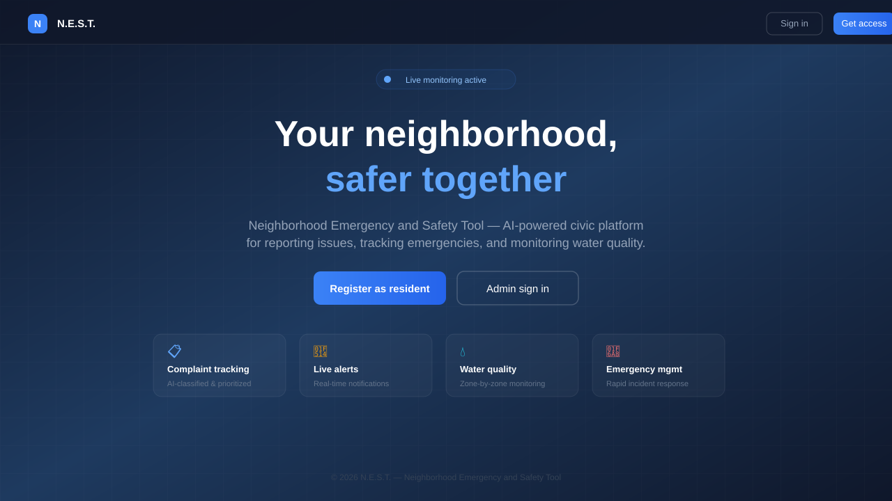
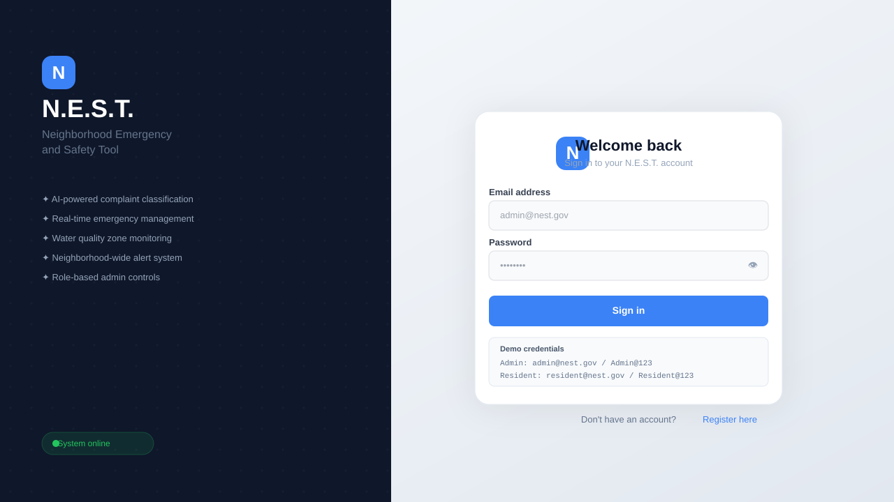
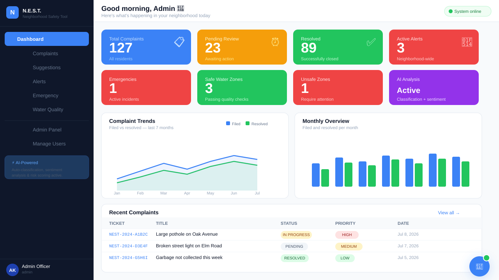
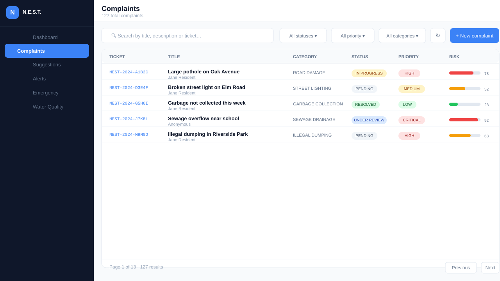
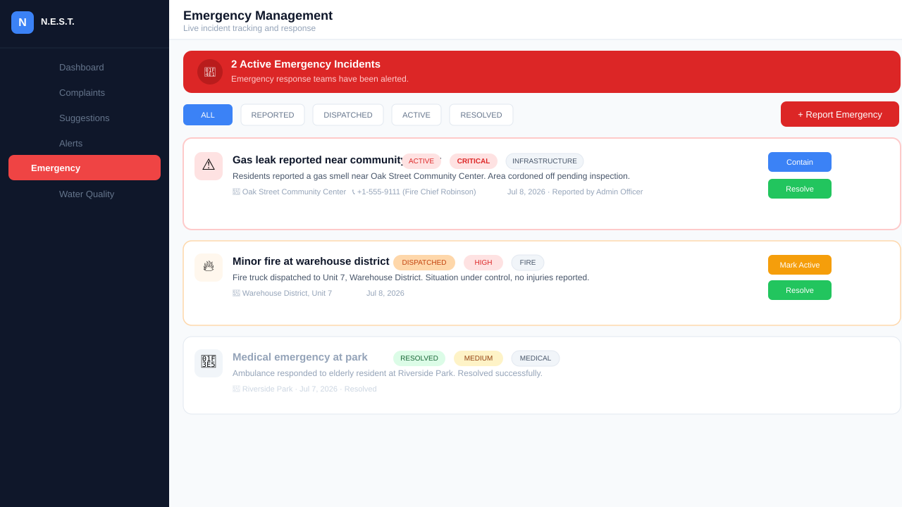
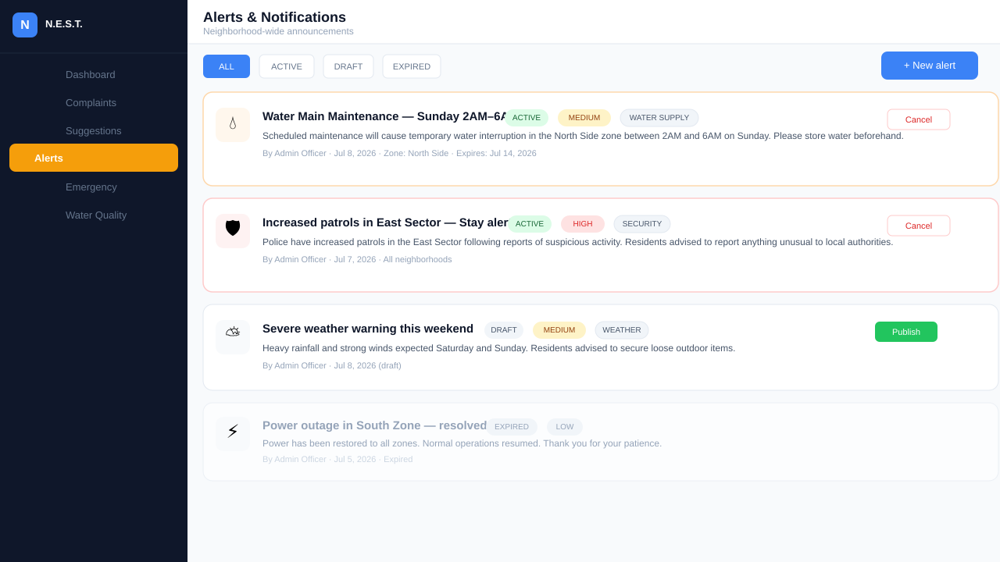
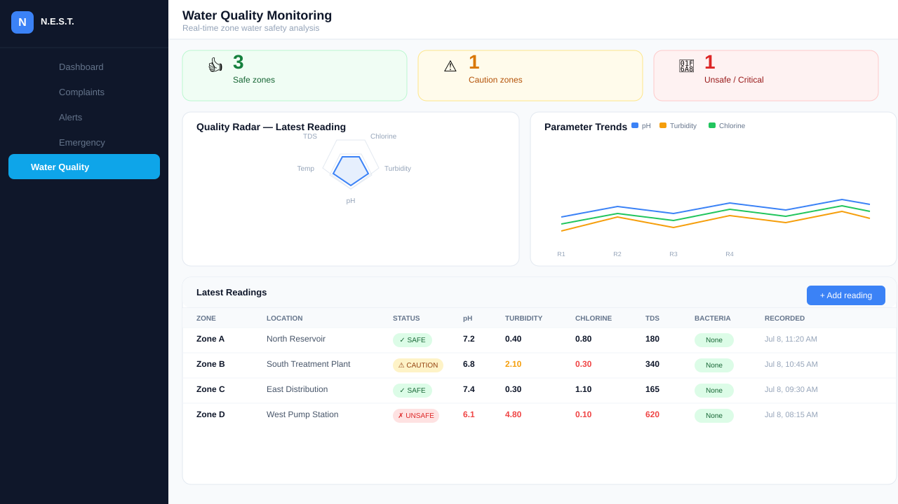
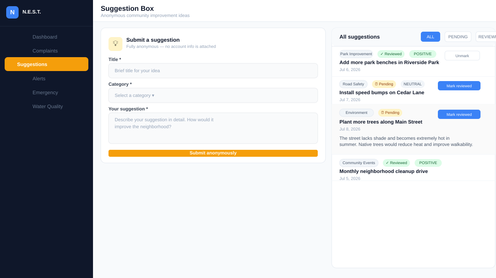
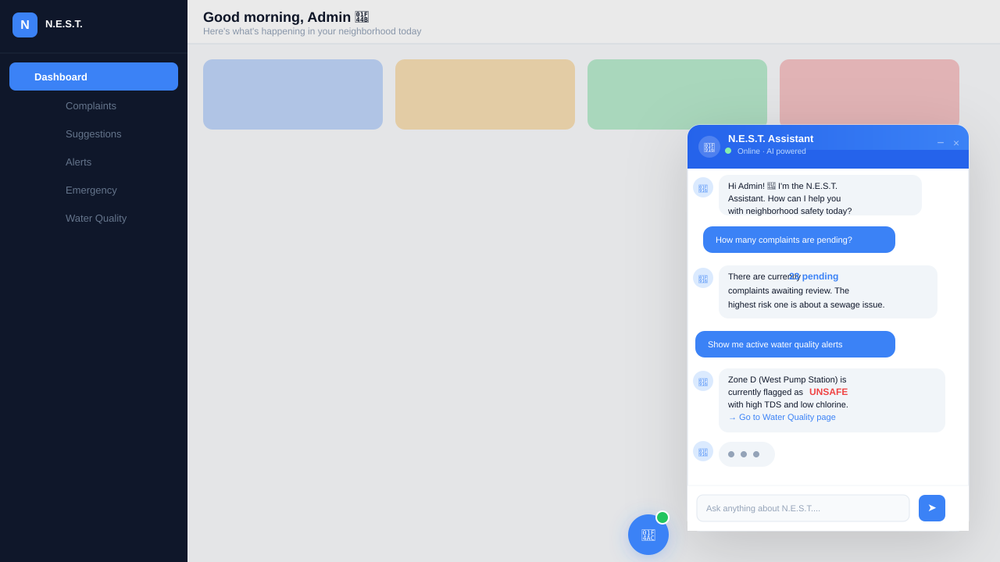
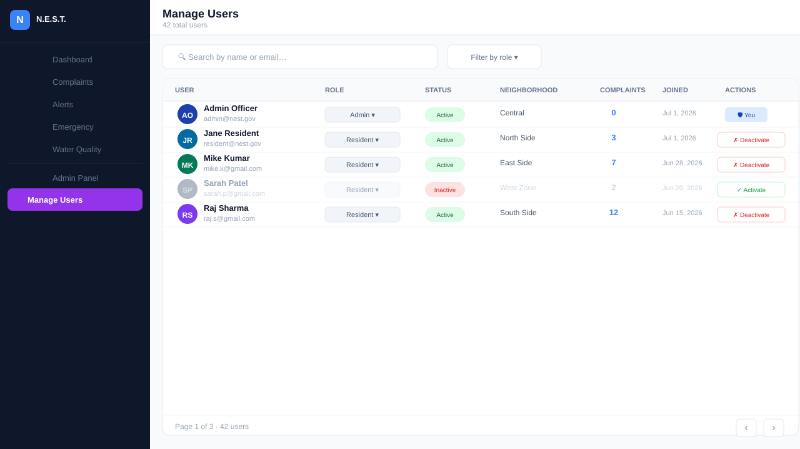

<div align="center">


# 🛡️ N.E.S.T.
### Neighborhood Emergency and Safety Tool

**AI-powered civic platform for residents and administrators to manage neighborhood safety, complaints, alerts, and emergencies.**


</div>

---

## 📸 Screenshots

### 🏠 Landing Page


---

### 🔐 Login


---

### 📊 Dashboard


---

### 📋 Complaints Management


---

### 🚨 Emergency Management


---

### 🔔 Alerts & Notifications


---

### 💧 Water Quality Monitoring


---

### 💡 Suggestion Box


---

### 🤖 AI Chat Assistant


---

### 🛡️ Admin Panel


---

### 👥 User Management


---

## ✨ Features

| Feature | Description |
|---|---|
| 🔐 **Authentication** | Email/password login, role-based access (Resident / Admin / Super Admin) |
| 📊 **Dashboard** | Live stats, Recharts area + bar charts, recent activity feed |
| 📋 **Complaints** | File, track, comment, AI auto-classification + risk scoring |
| 💡 **Suggestions** | Fully anonymous community idea box with sentiment analysis |
| 🔔 **Alerts** | Neighborhood-wide alerts with auto fan-out notifications |
| 🚨 **Emergency** | Live incident board with status progression (Reported → Resolved) |
| 💧 **Water Quality** | Zone-by-zone monitoring with WHO threshold enforcement + auto-alerts |
| 🤖 **AI Classifier** | Auto-categorises complaints using Claude claude-sonnet-4-6 |
| 💬 **Sentiment Analysis** | Detects complaint/suggestion emotional tone |
| ⚠️ **Risk Scoring** | Auto-escalates complaint priority based on 0–100 risk score |
| 🧠 **AI Chat** | Floating assistant with conversation history and quick prompts |
| 📝 **Audit Log** | Tracks all admin actions with before/after snapshots |

---

## 🛠️ Tech Stack

| Layer | Technology |
|---|---|
| **Framework** | Next.js 15 (App Router) |
| **Language** | TypeScript |
| **Styling** | Tailwind CSS + ShadCN UI |
| **Database** | PostgreSQL on Neon |
| **ORM** | Prisma |
| **Auth** | NextAuth v5 (JWT) |
| **AI** | Anthropic Claude (claude-sonnet-4-6) |
| **Charts** | Recharts |
| **Deployment** | Vercel |

---

## 🚀 Quick Start

```bash
# 1. Clone & install
git clone https://github.com/avinash09-cmd/nest-app.git
cd nest-app
npm install

# 2. Set up environment
cp .env.example .env.local
# Fill in DATABASE_URL, NEXTAUTH_SECRET, ANTHROPIC_API_KEY

# 3. Set up database
npx prisma generate
npx prisma db push
npx tsx prisma/seed.ts

# 4. Run
npm run dev
```

Visit **http://localhost:3000** 🎉

---

## 🔑 Demo Credentials

| Role | Email | Password |
|---|---|---|
| **Admin** | admin@nest.gov | Admin@123 |
| **Resident** | resident@nest.gov | Resident@123 |

---

## 🤖 AI Pipeline

Every complaint goes through a 3-step async pipeline:

```
POST /api/complaints
        ↓
POST /api/ai/classify     →  category + confidence + summary
        ↓
POST /api/ai/sentiment    →  POSITIVE / NEUTRAL / NEGATIVE + score
        ↓
POST /api/ai/risk-score   →  0–100 score, auto-escalates priority
```

All steps are **fire-and-forget** — instant response, AI enriches in background.

---

## 📁 Project Structure

```
src/
├── app/
│   ├── (auth)/          # Login, Register
│   ├── (dashboard)/     # All protected pages
│   └── api/             # REST API routes
│       └── ai/          # classify / sentiment / risk-score / chat
├── components/
│   ├── ai/              # ChatAssistant widget
│   ├── layout/          # Sidebar, TopBar, MobileNav
│   └── dashboard/       # StatsCard
├── lib/
│   ├── auth.ts          # NextAuth config
│   ├── prisma.ts        # DB singleton
│   └── validations.ts   # Zod schemas
└── middleware.ts        # Route protection
```

---

## 🔒 Security

- bcrypt password hashing (cost factor 12)
- httpOnly JWT cookies
- 3-layer RBAC (middleware + layout + API)
- IDOR prevention on all queries
- Security headers (X-Frame-Options, nosniff, etc.)
- Rate limiting on anonymous suggestions
- Zod validation on all endpoints

---

## 🌐 Deploy to Vercel

1. Push to GitHub
2. Import on [vercel.com](https://vercel.com)
3. Add env vars: `DATABASE_URL`, `NEXTAUTH_SECRET`, `NEXTAUTH_URL`, `ANTHROPIC_API_KEY`
4. Deploy — auto-runs `prisma generate && next build`

---

<div align="center">

---

### 💙 Made with Love by Avinash Kumar Singh

*B.Tech CSE (Cyber Security & Digital Forensics) · VIT Bhopal*

[](https://github.com/avinash09-cmd)

*"Building safer neighborhoods, one commit at a time."* 🛡️

---

</div>

